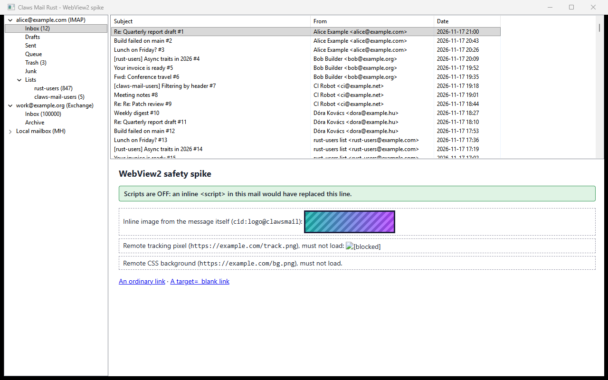

# Spike B findings: Win32 shell with a WebView2 mail view

**Verdict: the approach works.** Native common controls through `windows-rs` and the system WebView2 through raw COM
(`webview2-com`) give a Claws-style three-pane window. The release exe is 331 KiB. All seven safety rules hold, and
were checked at run time with positive controls where a negative result alone would prove nothing. `wry` was not
needed.

## What was built

- `src/main.rs`: the top-level window, a folder TreeView, a virtual report ListView (`LVS_OWNERDATA`, 100,000 rows),
  fixed splits, DPI handling, timers for the scripted checks, `--exit-after`.
- `src/mailview.rs`: the WebView2 environment, the controller and every safety hook.
- `src/mail.rs`: the sample message (a hostile-ish newsletter), its `cid:` part, the `cid:` rewrite and the CSP
  wrapper. Unit tests check the rewrite and that the CSP meta tag comes first.
- `src/rows.rs`: fake rows generated on demand, so 100k rows cost no memory.
- `app.manifest` + `build.rs`: the manifest is embedded by the MSVC linker (`/MANIFEST:EMBED /MANIFESTINPUT`),
  with no `rc.exe` and no extra crate.
- `assets/logo.png`: a 2.4 KB, 192x48 PNG used as the inline `cid:` image.

Options: `--exit-after <s>`, `--capture <png>` (CapturePreview), `--scroll-to <row>`, `--rows <n>`,
`--resize <w>x<h>`, `--log <file>`, and the positive controls `--allow-scripts`, `--no-csp` and `--allow-menus`.
run_hidden shares the console, so piping its output captures nothing; use `--log`.

    (Get-Process -Id $PID).PriorityClass = 'Idle'; cargo build --release
    L:\dev\tools\run_hidden\run_hidden.ps1 -Timeout 30 -Screenshot shots\w.png -ShotAfter 5 `
        .\target\release\webview-spike.exe --exit-after 7 --capture shots\c.png --log shots\run.log

## Crates and versions (checked on crates.io, 2026-11-17)

| Crate | Version | Notes |
| --- | --- | --- |
| `windows` | 0.62.2 | Must be the same version that `webview2-com` uses, or the COM types do not unify. `windows-core` 0.100 exists, but `webview2-com` is still on 0.62. |
| `webview2-com` | 0.39.1 | Raw COM bindings plus closure-based `*Handler::create` helpers, and `CoreWebView2EnvironmentOptions`. |
| `webview2-com-sys` | 0.39.1 | Transitive dependency. On MSVC it links `WebView2LoaderStatic.lib`, so no `WebView2Loader.dll` ships; the release exe's import table confirms this. |

Toolchain: Rust 1.100.0, edition 2024, `x86_64-pc-windows-msvc`. WebView2 Runtime 157.0.4341.46.

## The seven safety rules

The logs are in `shots/*.log`.

| # | Rule | How | Evidence |
| --- | --- | --- | --- |
| 1 | Scripts off | `SetIsScriptEnabled(false)` before the first navigation. The CSP also has no `script-src`. | **Default run:** `DocumentTitle` unchanged, and the probe reports `page script ran = false`. **With `--no-csp`:** the script still does not run, so `IsScriptEnabled` alone stops it. **Positive control `--allow-scripts`:** the title becomes "SCRIPT RAN", the page turns red and the verdict is `true`. |
| 2 | Remote requests blocked | A `*` filter covering all contexts and source kinds (`ICoreWebView2_22::AddWebResourceRequestedFilterWithRequestSourceKinds`). `WebResourceRequested` answers everything that is not `cid` with a 403 and logs `[blocked] <url>`. | Two layers. **Default run:** the CSP stops the tracker and the CSS background in the renderer before any request exists, and the violations are logged through the DevTools protocol `Log.entryAdded`. **With `--no-csp`:** the handler blocks both. `tracker=0x0` in every run. |
| 3 | `cid:` images from the message's own parts | `cid:X` is rewritten to `https://cid.invalid/X`, and the handler answers from `SHCreateMemStream` with a 200 and the part's content type. The CSP allows exactly `img-src https://cid.invalid`. | `[cid] served https://cid.invalid/logo@clawsmail (image/png, 2409 bytes)`; the probe reports `cid-img=192x48`; the image is visible in every screenshot. |
| 4 | Navigation away cancelled | `NavigationStarting` lets through only the single navigation flagged just before `NavigateToString`; everything else gets `SetCancel(true)` and its URL is printed. `FrameNavigationStarting` cancels all frame navigations. `NewWindowRequested` is handled without creating a window. | A `<meta refresh>` and host-script clicks on both links were all cancelled or blocked, and the page was unchanged afterwards. |
| 5 | Content loaded with `NavigateToString` under a strict CSP | The CSP meta tag comes first in `<head>`, before anything from the message: `default-src 'none'; img-src https://cid.invalid; style-src 'unsafe-inline'; font-src 'none'; media-src 'none'; object-src 'none'; frame-src 'none'; form-action 'none'; base-uri 'none'`. | The `[csp]` line in each log, the violation reports, and a unit test. |
| 6 | Context menus and devtools off | `SetAreDefaultContextMenusEnabled(false)`, `SetAreDevToolsEnabled(false)` and `SetAreBrowserAcceleratorKeysEnabled(false)`. Web messages, script dialogs, the status bar, autofill and SmartScreen are also off. | The settings read back as false. A posted right click raised 0 `ContextMenuRequested` events; with `--allow-menus` it raised 1. For devtools, the only evidence is the read-back. |
| 7 | User data folder in temp | `%TEMP%\clawsmail-rust-spike\webview2`. | No `*.WebView2` folder appeared next to the exe at start or at exit. The real app will use `%LOCALAPPDATA%\clawsmail-rust\WebView2`, or a folder next to the exe with `--portable`. |

## Hidden-desktop rendering, resizing and DPI

- **WebView2 paints normally on run_hidden's hidden desktop**, and `PrintWindow` captures it. `--capture`
  (CapturePreview) also works and gives just the view. Both can be used for GUI tests.
- **Resizing:** after `--resize 960x600`, the tree and list rectangles and the controller's `Bounds` all match the
  computed layout.
- **DPI:** Per-Monitor-V2 and comctl32 v6 were confirmed at run time. The hidden desktop is at 96 DPI, so
  `WM_DPICHANGED` and scaling above 100% are **not exercised**. This needs a check on a real high-DPI monitor.

## Native shell

- **Virtual ListView with 100,000 rows:** `LVM_SETITEMCOUNT` takes 0.2–0.8 ms. In release, jumping to the last row
  plus a repaint takes 3–4 ms. Each repaint asks for about 75 cells, so the cost depends on the number of visible rows,
  not on the row count.
- Both controls use `SetWindowTheme(..., "Explorer")`.

## Size and memory

- **Release exe: 338,944 bytes (331 KiB)** with thin LTO, `codegen-units = 1`, strip and `panic = "abort"`. It
  imports `VCRUNTIME140.dll`; consider `+crt-static` for release builds.
- **Idle memory**, release build, 15 s after start:

| Process | Private |
| --- | ---: |
| webview-spike.exe | 6.0 MB |
| msedgewebview2 browser | 33.4 MB |
| gpu-process | 78.5 MB |
| renderer | 20.9 MB |
| two utility processes | 14.2 + 7.2 MB |
| crashpad-handler | 2.7 MB |
| **Total** | **162.9 MB** |

  The GPU process may be inflated on the hidden desktop; measure it again on a real desktop.

## Pitfalls and observations

- **COM threading:** `CoInitializeEx(COINIT_APARTMENTTHREADED)` on the UI thread. WebView2 calls every handler back
  through the normal message loop. Nothing blocks or pumps inside the window procedure.
- **Re-entrancy:** WebView2 calls and `SendMessage` to the list re-enter the window procedure (`LVN_GETDISPINFO`
  arrives during `LVM_ENSUREVISIBLE`). Copy handles and COM pointers out of `RefCell`s before any call that can
  re-enter. A `BorrowMutError` inside an `extern "system"` callback aborts without a message.
- **Bounds before the controller exists:** `WM_SIZE` arrives before the asynchronous controller is ready, so keep a
  pending rect and apply it once it is.
- **`NavigateToString` raises `NavigationStarting` itself**, with a `data:` URI. Allow it with a one-shot flag, not by
  matching the URL, so a mail cannot slip in a `data:` link of its own.
- **`IsUserInitiated` is `true` for `<meta refresh>`** and for host-script `click()`, so the app cannot use it to
  decide whether to open the system browser. The sanitiser must drop `<meta http-equiv>`, and the shell should open
  the browser only for clicks the user really made.
- **The CSP hides requests from the handler:** requests the CSP blocks never reach `WebResourceRequested`. Keep both
  layers.
- **`ExecuteScript` still runs while `IsScriptEnabled=false`.** Useful for host features such as find-in-page.
- **`NavigationCompleted` fires for cancelled navigations too** (status 14, operation cancelled). Match the
  navigation ID before treating it as "content loaded".
- **`NavigateToString` is limited to about 2 MB** (per the docs; not tested here). Serve large mail through the
  request handler from a `https://msg.invalid/...` URL, with the CSP as a response header.
- The spike uses the console subsystem. The real app will use `windows_subsystem = "windows"` and log to a file.

## Not done or not verified

- High DPI and moving between monitors.
- `FrameNavigationStarting` and plain `http:` blocking: implemented, but never triggered.
- Opening DevTools with a key: only the setting was checked.
- Draggable splitters, ammonia sanitising, keyboard focus between panes, printing.
- `run3_scripts_on_window.png` and `run4_list_end_window.png` come from the debug build. Everything else comes from the
  final release build.
